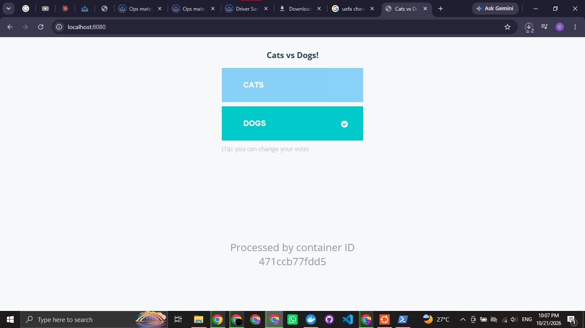
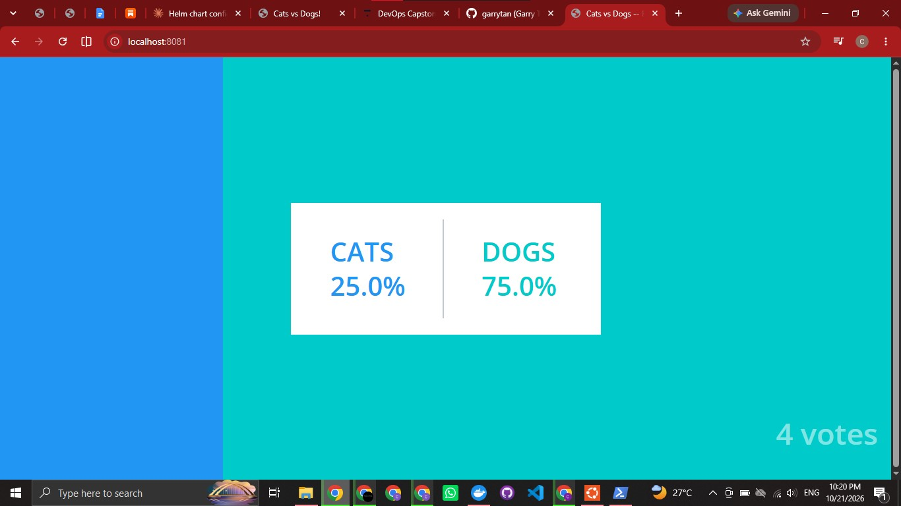
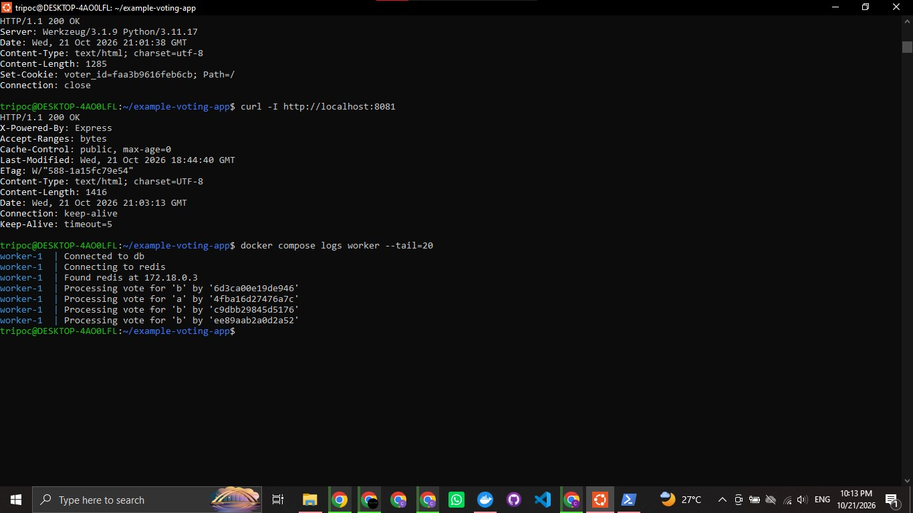

# DevOps Capstone 1: Voting App

Forked from [dockersamples/example-voting-app](https://github.com/dockersamples/example-voting-app). The original README is kept as [ORIGINAL_README.md](ORIGINAL_README.md).

The raw working notes are in [docs/PROGRESS.md](docs/PROGRESS.md).

## Step 1: Run it locally

- Forked the repo to my GitHub account, cloned it, and added the original as the `upstream` remote.
- Ran the app with `docker compose up -d --build`.
- Vote page: http://localhost:8080
- Result page: http://localhost:8081

First build hit DNS timeouts while pulling base images. Retrying the pulls fixed it and all three images built.

### Proof

Vote page after casting a vote:



Result page showing the count:



All containers running:



## Step 2: Containerize it safely

- **Pinned base images** by digest in all three Dockerfiles (`python:3.11-slim`, `node:18-slim`, `dotnet/sdk:7.0` and `dotnet/runtime:7.0`), so builds are reproducible.
- **Non-root:** vote and worker run as `appuser` (UID 10001); result runs as the built-in `node` user (UID 1000).
- **`.dockerignore`** added for vote and worker and tightened for result, so `node_modules`, `bin/obj`, `.git`, env files and keys stay out of the build context.

### Verification

```text
docker compose exec vote id     -> uid=10001(appuser)
docker compose exec result id   -> uid=1000(node)
docker compose exec worker id   -> uid=10001(appuser)
docker build --target final ./vote  -> builds and serves HTTP 200
```

## Setup and issues hit so far

### Environment

- Windows with Ubuntu on WSL 2, Docker Desktop with WSL integration enabled for the Ubuntu distro.
- Git authentication over HTTPS with a GitHub personal access token (repo and workflow scopes), stored outside the repo.

### Issues and fixes

| Issue | Cause | Fix |
|---|---|---|
| `docker: command not found` in Ubuntu | Docker Desktop WSL integration was off | Enabled it under Settings, Resources, WSL integration, then `wsl --shutdown` and reopened Ubuntu |
| Image pulls and `pip install` failed with `no such host` during builds | Intermittent DNS failures inside Docker | Retried the build loop, and set public DNS (8.8.8.8, 1.1.1.1) in Docker Engine settings |
| `Password authentication is not supported` on clone | GitHub no longer accepts account passwords for Git | Used a personal access token as the password |
| `:Zone.Identifier` files appeared next to screenshots | Windows metadata added when copying files into WSL | Deleted them and added `*:Zone.Identifier` to `.gitignore` |

## Step 3: Kubernetes cluster with Terraform

I do not have access to a cloud account (no AWS account), so the cluster is a local [kind](https://kind.sigs.k8s.io/) cluster created with Terraform (`tehcyx/kind` provider). It runs in Docker on my machine, so it is **not** in a cloud default VPC. This is a limitation of this submission.

- Code: [terraform/main.tf](terraform/main.tf) and [terraform/outputs.tf](terraform/outputs.tf)
- One control-plane node, with NodePorts 31000 (vote) and 31001 (result) mapped to the host
- The kubeconfig and Terraform state are excluded from Git

```bash
cd terraform
terraform init
terraform apply
export KUBECONFIG=$PWD/kubeconfig
kubectl get nodes
```

### Verification

`terraform destroy` followed by `terraform apply` brought the cluster back from code alone, and `kubectl get nodes` showed `capstone-control-plane` as `Ready`.

### Issue hit

Pulling the `kindest/node` image failed repeatedly with `unexpected EOF` and TLS handshake timeouts on an unstable connection. Retrying `docker pull` in a loop fixed it, since Docker keeps layers that already downloaded.

### Issue: Trivy gate failed on the result image

The first pipeline run blocked the result image on 7 fixable CRITICAL findings: `libgnutls30` and `perl-base` in the Debian base, `proxy-addr` in the app's lockfile, and `tar` bundled inside npm. Fixes, kept minimal:

- Added `apt-get upgrade` to the Dockerfile so Debian security patches are applied. A newer `node:18-slim` would not help because Node 18 is end of life and its images are no longer rebuilt.
- Refreshed `package-lock.json` so `proxy-addr` resolves to 2.0.8.
- Removed npm from the final image, since it is only needed at build time. This also removes its bundled `tar`.

The longer-term fix is moving to a supported Node version.

### Issue: Trivy gate failed on the worker image

The worker failed the gate on 7 fixable CRITICAL findings: `libgnutls30` and the `krb5` libraries in the Debian base, and `System.Drawing.Common` 5.0.0 in the app dependencies. Trivy also warned that the base OS (Debian 11) is no longer supported. The default `dotnet/runtime:7.0` tag is the Debian 11 variant. Fixes, kept minimal:

- Switched the runtime stage to `dotnet/runtime:7.0-bookworm-slim` (same .NET 7 runtime on Debian 12), pinned by digest, and added `apt-get upgrade` so security patches are applied.
- Added an explicit `System.Drawing.Common` 5.0.3 package reference to override the vulnerable transitive version.

.NET 7 itself is end of life. The longer-term fix is moving the worker to a currently supported .NET version.

### Issue: Trivy gate failed on the worker image

The worker failed the gate on 7 fixable CRITICAL findings: `libgnutls30` and the `krb5` libraries in the Debian base, and `System.Drawing.Common` 5.0.0 in the app dependencies. Trivy also warned that the base OS (Debian 11) is no longer supported. The default `dotnet/runtime:7.0` tag is the Debian 11 variant. Fixes, kept minimal:

- Switched the runtime stage to `dotnet/runtime:7.0-bookworm-slim` (same .NET 7 runtime on Debian 12), pinned by digest, and added `apt-get upgrade` so security patches are applied.
- Added an explicit `System.Drawing.Common` 5.0.3 package reference to override the vulnerable transitive version.

.NET 7 itself is end of life. The longer-term fix is moving the worker to a currently supported .NET version.
