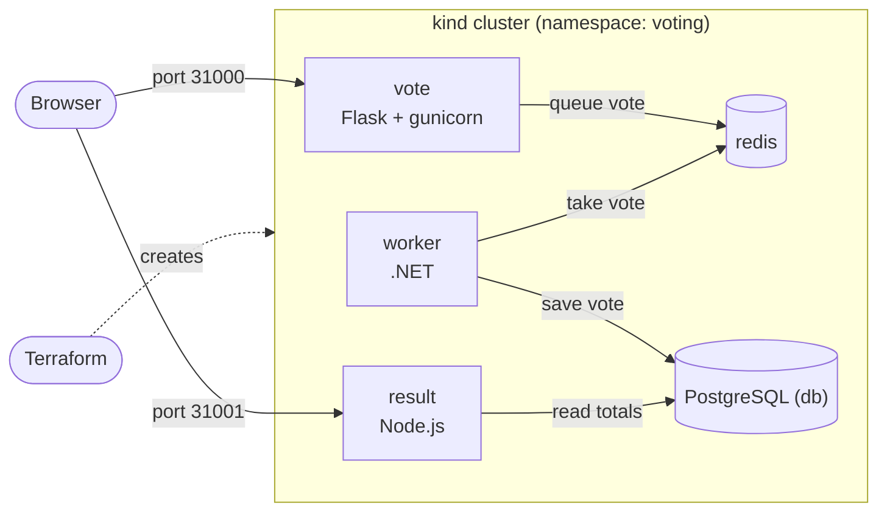
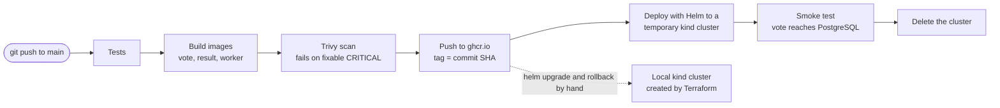
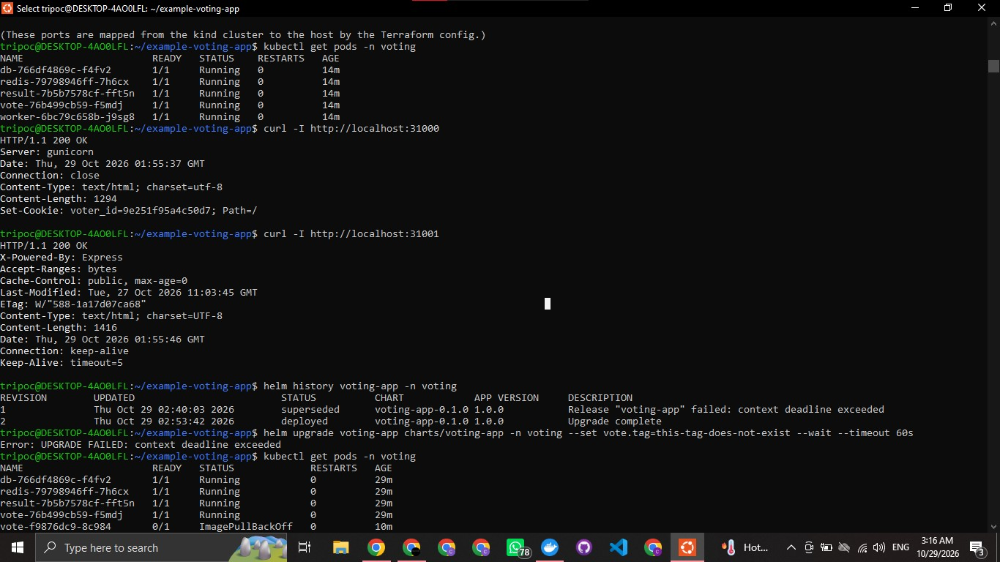
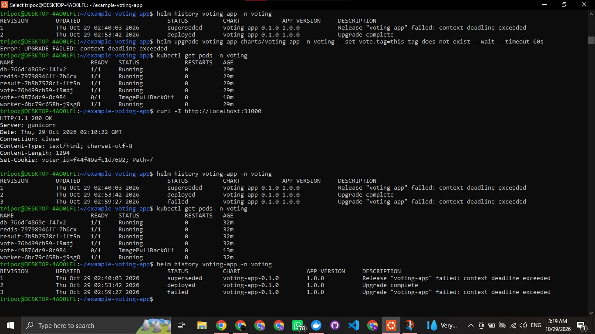
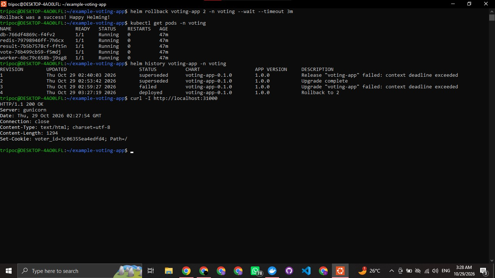
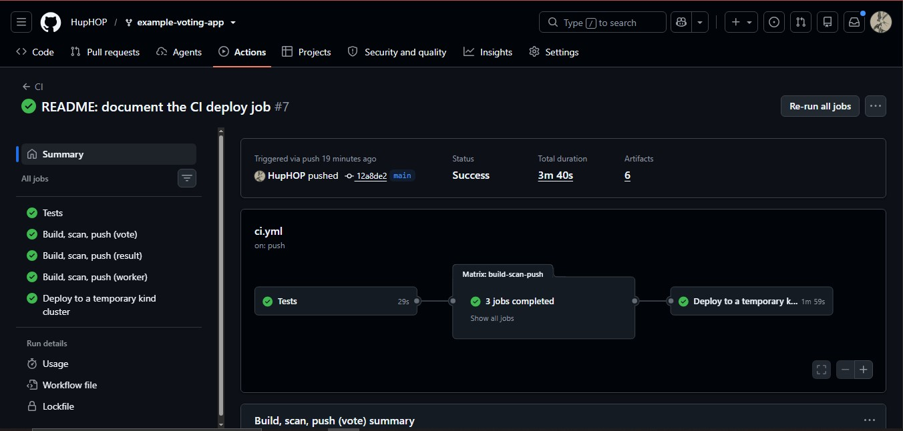
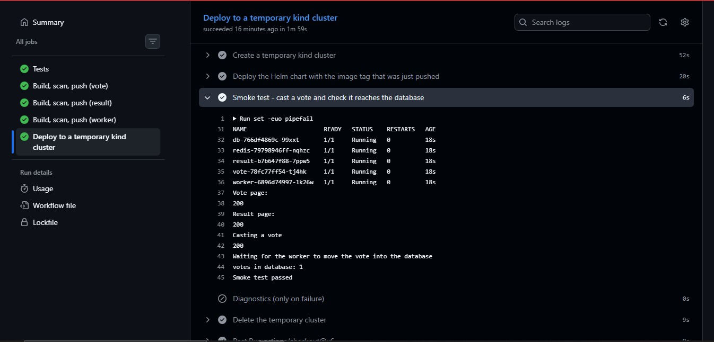

# DevOps Capstone 1: Voting App

Forked from [dockersamples/example-voting-app](https://github.com/dockersamples/example-voting-app). The original README is kept as [ORIGINAL_README.md](ORIGINAL_README.md).

The raw working notes are in [docs/PROGRESS.md](docs/PROGRESS.md).

## Overview

This project takes the Docker example voting app from code to an automatic, reproducible deployment: hardened containers, a Terraform-built Kubernetes cluster, a GitHub Actions pipeline that builds, scans and deploys, and a Helm chart with rollback.

### Architecture



### CI/CD pipeline



### Repository map

| Path | What it is |
|---|---|
| `vote/`, `result/`, `worker/` | The three services, with hardened Dockerfiles (pinned base images, non-root, `.dockerignore`) |
| `terraform/` | Terraform code that creates the local kind cluster |
| `charts/voting-app/` | The Helm chart: one chart, one values file |
| `.github/workflows/ci.yml` | The CI/CD pipeline |
| `docs/PROGRESS.md` | Raw working log |
| `docs/images/` | Screenshots used as evidence |

### Reproduce it

Requirements: Docker, Terraform, kubectl and Helm.

```bash
cd terraform
terraform init
terraform apply
export KUBECONFIG=$PWD/kubeconfig
cd ..
helm upgrade --install voting-app charts/voting-app --namespace voting --create-namespace --wait --timeout 10m
```

Vote at http://localhost:31000 and see the results at http://localhost:31001.

### Requirements checklist

| Requirement | How it is met |
|---|---|
| One push builds, scans and deploys | `ci.yml`: tests, build, Trivy scan, push to ghcr.io, then a deploy job with an end-to-end smoke test (see Step 4) |
| The environment rebuilds from code | `terraform destroy` then `terraform apply` recreates the cluster, and `helm upgrade --install` redeploys the app (see Step 3 and Step 5) |
| No secrets in Git | ghcr.io login uses the built-in `GITHUB_TOKEN`; Terraform state and kubeconfig are git-ignored; tracked files and history were scanned for keys and tokens |
| Rollback is shown live | `helm rollback` after a deliberately bad release (see Step 5) |

### Known limitations

- The cluster is a local kind cluster created with Terraform, not a cloud cluster in a default VPC, because I have no cloud account.
- The CI deploy job deploys to a disposable cluster. The long-lived local cluster is deployed with Helm by hand.
- .NET 7 and Node 18 are past end of life. The images are patched at the OS level, but the runtimes should be upgraded.
- The database credentials are demo values hardcoded in the application code, and redis and Postgres use `emptyDir` storage.

## Step 1: Run it locally

- Forked the repo to my GitHub account, cloned it, and added the original as the `upstream` remote.
- Ran the app with `docker compose up -d --build`.
- Vote page: http://localhost:8080
- Result page: http://localhost:8081

First build hit DNS timeouts while pulling base images. Retrying the pulls fixed it and all three images built.

### Proof

Vote page after casting a vote:


Result page showing the count:


All containers running:


## Step 2: Containerize it safely

- **Pinned base images** by digest in all three Dockerfiles (`python:3.11-slim`, `node:18-slim`, `dotnet/sdk:7.0` and `dotnet/runtime:7.0`), so builds are reproducible.
- **Non-root:** vote and worker run as `appuser` (UID 10001); result runs as the built-in `node` user (UID 1000).
- **`.dockerignore`** added for vote and worker and tightened for result, so `node_modules`, `bin/obj`, `.git`, env files and keys stay out of the build context.

### Verification

```text
docker compose exec vote id     -> uid=10001(appuser)
docker compose exec result id   -> uid=1000(node)
docker compose exec worker id   -> uid=10001(appuser)
docker build --target final ./vote  -> builds and serves HTTP 200
```

## Setup and issues hit so far

### Environment

- Windows with Ubuntu on WSL 2, Docker Desktop with WSL integration enabled for the Ubuntu distro.
- Git authentication over HTTPS with a GitHub personal access token (repo and workflow scopes), stored outside the repo.

### Issues and fixes

| Issue | Cause | Fix |
|---|---|---|
| `docker: command not found` in Ubuntu | Docker Desktop WSL integration was off | Enabled it under Settings, Resources, WSL integration, then `wsl --shutdown` and reopened Ubuntu |
| Image pulls and `pip install` failed with `no such host` during builds | Intermittent DNS failures inside Docker | Retried the build loop, and set public DNS (8.8.8.8, 1.1.1.1) in Docker Engine settings |
| `Password authentication is not supported` on clone | GitHub no longer accepts account passwords for Git | Used a personal access token as the password |
| `:Zone.Identifier` files appeared next to screenshots | Windows metadata added when copying files into WSL | Deleted them and added `*:Zone.Identifier` to `.gitignore` |

## Step 3: Kubernetes cluster with Terraform

I do not have access to a cloud account (no AWS account), so the cluster is a local [kind](https://kind.sigs.k8s.io/) cluster created with Terraform (`tehcyx/kind` provider). It runs in Docker on my machine, so it is **not** in a cloud default VPC. This is a limitation of this submission.

- Code: [terraform/main.tf](terraform/main.tf) and [terraform/outputs.tf](terraform/outputs.tf)
- One control-plane node, with NodePorts 31000 (vote) and 31001 (result) mapped to the host
- The kubeconfig and Terraform state are excluded from Git

```bash
cd terraform
terraform init
terraform apply
export KUBECONFIG=$PWD/kubeconfig
kubectl get nodes
```

### Verification

`terraform destroy` followed by `terraform apply` brought the cluster back from code alone, and `kubectl get nodes` showed `capstone-control-plane` as `Ready`.

### Issue hit

Pulling the `kindest/node` image failed repeatedly with `unexpected EOF` and TLS handshake timeouts on an unstable connection. Retrying `docker pull` in a loop fixed it, since Docker keeps layers that already downloaded.

### Issue: Trivy gate failed on the result image

The first pipeline run blocked the result image on 7 fixable CRITICAL findings: `libgnutls30` and `perl-base` in the Debian base, `proxy-addr` in the app's lockfile, and `tar` bundled inside npm. Fixes, kept minimal:

- Added `apt-get upgrade` to the Dockerfile so Debian security patches are applied. A newer `node:18-slim` would not help because Node 18 is end of life and its images are no longer rebuilt.
- Refreshed `package-lock.json` so `proxy-addr` resolves to 2.0.8.
- Removed npm from the final image, since it is only needed at build time. This also removes its bundled `tar`.

The longer-term fix is moving to a supported Node version.

### Issue: Trivy gate failed on the worker image

The worker failed the gate on 7 fixable CRITICAL findings: `libgnutls30` and the `krb5` libraries in the Debian base, and `System.Drawing.Common` 5.0.0 in the app dependencies. Trivy also warned that the base OS (Debian 11) is no longer supported. The default `dotnet/runtime:7.0` tag is the Debian 11 variant. Fixes, kept minimal:

- Switched the runtime stage to `dotnet/runtime:7.0-bookworm-slim` (same .NET 7 runtime on Debian 12), pinned by digest, and added `apt-get upgrade` so security patches are applied.
- Added an explicit `System.Drawing.Common` 5.0.3 package reference to override the vulnerable transitive version.

.NET 7 itself is end of life. The longer-term fix is moving the worker to a currently supported .NET version.

### Issue: Trivy gate failed on the worker image

The worker failed the gate on 7 fixable CRITICAL findings: `libgnutls30` and the `krb5` libraries in the Debian base, and `System.Drawing.Common` 5.0.0 in the app dependencies. Trivy also warned that the base OS (Debian 11) is no longer supported. The default `dotnet/runtime:7.0` tag is the Debian 11 variant. Fixes, kept minimal:

- Switched the runtime stage to `dotnet/runtime:7.0-bookworm-slim` (same .NET 7 runtime on Debian 12), pinned by digest, and added `apt-get upgrade` so security patches are applied.
- Added an explicit `System.Drawing.Common` 5.0.3 package reference to override the vulnerable transitive version.

.NET 7 itself is end of life. The longer-term fix is moving the worker to a currently supported .NET version.

### Rollback evidence

The first install attempt (revision 1) timed out while the images were still downloading over a slow connection, so Helm marked it `failed`. Re-running the same command succeeded as revision 2, which is the healthy baseline for the demo.

**1. Baseline (revision 2).** All five pods running, and both the vote and result pages return `200 OK`.



**2. Bad release (revision 3).** Deployed on purpose with a vote image tag that does not exist:

```text
helm upgrade voting-app charts/voting-app -n voting --set vote.tag=this-tag-does-not-exist --wait --timeout 60s
```

The upgrade failed, the new vote pod went into `ImagePullBackOff`, and the release was marked `failed`. The old vote pod kept running, so the vote page still returned `200 OK`.



**3. Rollback (revision 4).**

```text
helm rollback voting-app 2 -n voting --wait --timeout 3m
```

Helm created revision 4 (`Rollback to 2`), the broken pod was removed, and all five pods are healthy again.



| Revision | Status | What happened |
|---|---|---|
| 1 | superseded | First install, timed out while images downloaded |
| 2 | deployed, then superseded | Successful install, the healthy baseline |
| 3 | failed | Bad release (nonexistent vote tag) |
| 4 | deployed | Rollback to revision 2 |

## Step 5: Deploy and roll back with Helm

One chart ([charts/voting-app](charts/voting-app)) and one values file ([values.yaml](charts/voting-app/values.yaml)) deploy the whole app: vote, result, worker, redis and db. The images come from ghcr.io, tagged with the commit SHA that CI built. Redis and Postgres are pinned by digest.

```text
helm upgrade --install voting-app charts/voting-app --namespace voting --create-namespace --wait --timeout 5m
```

Vote is at http://localhost:31000 and result at http://localhost:31001 (NodePorts mapped from the kind cluster to the host in the Terraform config).

### Design notes

- **Service names `db` and `redis` are fixed.** The application code connects to those hostnames, so the services cannot take release-prefixed names.
- **Port 80 as non-root.** The vote and result images run as non-root users but listen on port 80, so the pod sets the `net.ipv4.ip_unprivileged_port_start` sysctl to 0. Containers also drop all capabilities and disallow privilege escalation.
- **Demo credentials.** The database credentials (`postgres`/`postgres`) are hardcoded in the application code, so they sit in `values.yaml`. They protect nothing real and cannot be changed without changing the app.
- **Storage is an emptyDir** for redis and Postgres, so data is lost if those pods are replaced. This is acceptable for a demo.
- **Resource requests and limits** are small because the local machine has limited memory.

### Rollback demo

The first install attempt (revision 1) timed out while the images were still downloading over a slow connection, so Helm marked it `failed`. Re-running the same command succeeded as revision 2, which is the healthy baseline for the demo.

**1. Baseline (revision 2).** All five pods running, and both the vote and result pages return `200 OK`.


**2. Bad release (revision 3).** Deployed on purpose with a vote image tag that does not exist:

```text
helm upgrade voting-app charts/voting-app -n voting --set vote.tag=this-tag-does-not-exist --wait --timeout 60s
```

The upgrade failed, the new vote pod went into `ImagePullBackOff`, and the release was marked `failed`. The old vote pod kept running, so the vote page still returned `200 OK`.


**3. Rollback.**

```text
helm rollback voting-app 2 -n voting --wait --timeout 3m
```

The rollback was run twice, both times to revision 2 (revisions 4 and 5), with the same result. The broken pod was removed and all five pods are healthy again.


| Revision | Status | What happened |
|---|---|---|
| 1 | superseded | First install, timed out while images downloaded |
| 2 | superseded | Successful install, the healthy baseline |
| 3 | failed | Bad release (nonexistent vote tag), `ImagePullBackOff` |
| 4 | superseded | First rollback to revision 2 |
| 5 | deployed | Second rollback to revision 2 (current) |

### Status

- Done: the chart, the deployment to the local cluster, the rollback, and the CI deploy job.
- To do: the architecture diagram and the final README tidy-up.

## CI deploy job (completes Step 4)

After the build, scan and push jobs succeed on a push to `main`, a `deploy` job in [ci.yml](.github/workflows/ci.yml) does the following on a GitHub-hosted runner:

1. Creates a temporary kind cluster (`kind`, `kubectl` and `helm` are preinstalled on the runner image, so no third-party action is needed).
2. Installs the Helm chart with `--set image.tag=<commit SHA>`, so it deploys the images that run just pushed to ghcr.io.
3. Runs an end-to-end smoke test: loads the vote and result pages, casts a vote, and polls Postgres until the worker has moved the vote into the `votes` table.
4. Deletes the cluster, even if a step failed. On failure it prints pod descriptions and logs first.

So one push builds, scans, deploys and verifies, with no manual step. This is the Option B approach described under Step 4: the pipeline deploys to a disposable cluster, not to my long-lived local cluster, because GitHub's runners cannot reach a cluster on my laptop and I have no cloud account. The real deployment and the rollback demo run against the local cluster with Helm (Step 5).

### CI evidence

All jobs green on a push to `main` (tests, build, scan and push for each image, then the deploy job):



The smoke test casts a vote and waits for it to appear in PostgreSQL:


